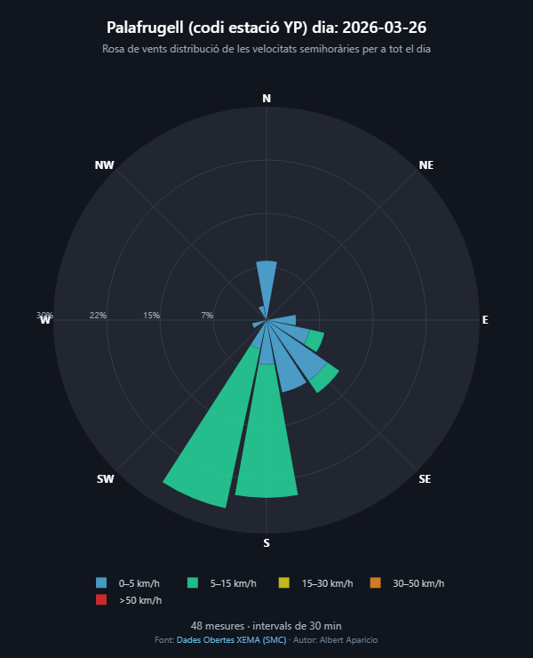
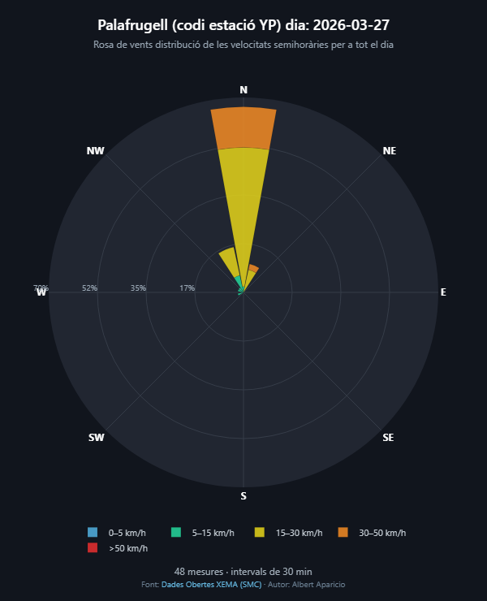
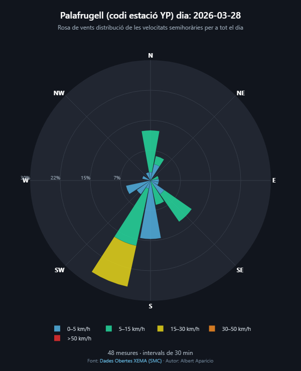

# Exploració i creació Rose chart, PAC2 Visualització de Dades. Rosa dels vents.

Exercici corresponent a la PAC2 de l'assignatura de Visualització de Dades del Màster en Ciència de Dades de la UOC

Tècnica de visualització a explorar: Rose chart.

Visualització elaborada amb Python:

## Descripció script

Script en Python per generar roses dels vents interactives a partir de mesures
de vent de la XEMA (Xarxa d'Estacions Meteorològiques Automàtiques del Servei
Meteorològic de Catalunya). Les dades d'exemple incloses corresponen a
Palafrugell (estació YP) i als dies 26, 27 i 28 de març de 2026.

## Requisits

- [Miniconda](https://docs.anaconda.com/miniconda/) o [Anaconda](https://www.anaconda.com/download)
- Connexió a Internet per carregar la biblioteca JavaScript de Plotly des del
  CDN quan s'obrin els gràfics HTML.

## Instal·lació amb Conda

Obre Anaconda Prompt o un terminal on estigui disponible `conda`, situa't a la
carpeta del projecte i crea l'entorn:

```powershell
cd "C:\Users\albert\Documents\UOC\Visualització de dades\PAC2"
conda create --name rosa-vents python=3.11 numpy pandas plotly
```

Activa l'entorn:

```powershell
conda activate rosa-vents
```

Els mòduls de Python necessaris són:

- `numpy`
- `pandas`
- `plotly`

## Execució

Amb l'entorn `rosa-vents` activat, executa:

```powershell
python wind_rose_chart.py
```

El programa processa les dades d'exemple incloses al mateix script i desa a la
carpeta actual un gràfic HTML per a cada dia:

- `rosa_vents_2026-03-26.html`
- `rosa_vents_2026-03-27.html`
- `rosa_vents_2026-03-28.html`

Obre qualsevol d'aquests fitxers amb un navegador web per explorar la rosa.
Les dades no es descarreguen automàticament: el programa conté les mesures
d'exemple i les interpreta en intervals de 30 minuts.

## Funcionament

L'script converteix les observacions de cada dia en una taula amb la velocitat
del vent (km/h) i la direcció (graus). Després agrupa les mesures en 16 sectors
de direcció i cinc intervals de velocitat (0–5, 5–15, 15–30, 30–50 i més de
50 km/h). Cada rosa de vents representa en percentatge la freqüència de les
direccions, amb els colors apilats corresponents als intervals de velocitat.

Els gràfics es generen amb Plotly i s'escriuen en format HTML. La funció
`wind_rose` permet indicar el nom de l'estació i el nom del fitxer de sortida;
`parse_dia` converteix el text de les observacions en una taula de dades.

## Exemple visualitzacions generades

Les imatges següents són una previsualització estàtica de cada gràfic. Fes clic
en una imatge per obrir la visualització HTML interactiva corresponent.

| 26 de març de 2026 | 27 de març de 2026 | 28 de març de 2026 |
| --- | --- | --- |
| <a href="./rosa_vents_2026-03-26.html"></a> | <a href="./rosa_vents_2026-03-27.html"></a> | <a href="./rosa_vents_2026-03-28.html"></a> |

Per carregar les visualitzacions interactives cal connexió a Internet, ja que
Plotly es carrega des del CDN.

## Llicència

Aquest projecte es distribueix sota els termes de la **GNU General Public
License, versió 3, de 29 de juny de 2007 (GPL-3.0)**. El text complet de la
llicència es pot consultar a
[gnu.org/licenses/gpl-3.0.html](https://www.gnu.org/licenses/gpl-3.0.html).

